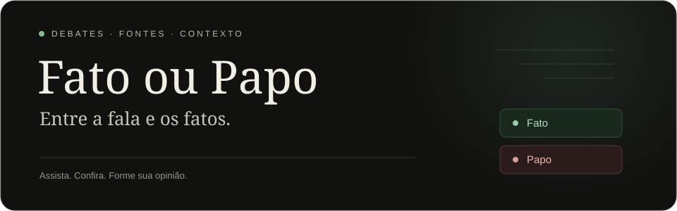

  

  <strong>Você assiste. Nós checamos.</strong> 
  Explore debates, confira afirmações e encontre as fontes por trás de cada conclusão.

  <a href="https://mreaggle.github.io/fatooupapo/"><strong>Acessar a plataforma ↗</strong></a>
  &nbsp; · &nbsp; <a href="https://mreaggle.github.io/fatooupapo/#acervo">Pesquisar no acervo</a>
  &nbsp; · &nbsp; <a href="#como-ler-os-resultados">Entender os resultados</a>

  

---

## A conversa fica melhor com contexto

Uma frase pode soar convincente e ainda misturar números, omitir um recorte ou apresentar uma previsão como certeza. O **Fato ou Papo** reúne a fala, o momento do vídeo e uma conclusão acompanhada de fontes para você conferir.

| Assista com contexto | Vá além do placar |
| :--- | :--- |
| **⏱️ Trechos no momento certo** — abra a fala diretamente no YouTube. | **🔎 Fontes à vista** — consulte os documentos e publicações usados na análise. |
| **💬 Transcrição para consultar** — acompanhe o texto integral disponível em cada relatório. | **📊 Visão por debatedor** — compare classificações e medidores com seu recorte explícito. |
| **🎨 Leitura por cores** — encontre a categoria da afirmação e a conclusão logo abaixo. | **🔗 Relatórios compartilháveis** — envie o link de um debate e abra a versão publicada. |

## Encontre uma checagem

1. **[Pesquise no acervo](https://mreaggle.github.io/fatooupapo/#acervo)** pelo título do vídeo ou pelo canal.
2. **Abra uma checagem publicada.** A consulta é gratuita e não consome créditos.
3. **Explore as falas e fontes.** Use a busca, confira os gráficos e ouça os trechos que quiser. Cada relatório informa sua cobertura em **Cobertura e origem**.

Em cada afirmação, **Compartilhar card** gera uma imagem com o argumento em destaque, a conclusão e sua classificação no gauge. Compartilhe pelo navegador ou baixe o PNG.

Para vídeos fora do acervo, solicite análise com uma conta GitHub e acompanhe o processamento. A estimativa de créditos aparece antes da confirmação. Os pedidos aceitam vídeos de até **4 horas** e avançam por lotes; não há um limite total de oito afirmações por debate.

Cada conta tem **100 créditos a cada 24 horas**. Vídeos com três horas ou mais consomem essa cota inteira; consultar o acervo continua livre.

## Como ler os resultados

| Categoria | O que a checagem encontrou |
| :--- | :--- |
| 🟢 **Fato** | A afirmação é sustentada pelas fontes consultadas. |
| 🟩 **Majoritariamente fato** | O núcleo está correto, com ressalvas explicadas na conclusão. |
| 🟡 **Impreciso ou fora de contexto** | Há mistura de indicadores, omissão de contexto ou formulação que altera o sentido dos dados. |
| 🟠 **Majoritariamente papo** | O núcleo é contradito pelas evidências, embora possa conter partes corretas. |
| 🔴 **Papo** | A afirmação é contradita pelas fontes consultadas. |
| ⚪ **Inconclusivo** | Não há evidência suficiente para uma conclusão segura. |

**O medidor não é uma nota da pessoa.** Ele mostra a proporção de Fatos entre Fatos e Papos atribuídos ao debatedor, incluindo “majoritariamente”. Imprecisos e inconclusivos aparecem nas barras e ficam fora dessa proporção. A classificação não estabelece intenção de mentir.

## Transparência faz parte da checagem

A IA auxilia a análise, e as conclusões apontam fontes e limitações. Uma legenda pode trocar um nome ou um número; a identificação textual do locutor também pode falhar. Quando faltar comprovação, o resultado permanece **Inconclusivo**.

Você pode revisar o locutor de um trecho no relatório. Essa revisão fica no seu navegador. Detalhes de metodologia, identificação e cálculos estão recolhidos para manter a leitura principal simples.

Encontrou um erro? [Abra um relato](https://github.com/Mreaggle/fatooupapo/issues/new) com o link do debate, o momento da fala e a fonte que ajuda a corrigir a conclusão.

---

  <strong>Confira a fala. Leia o contexto. Abra a fonte.</strong> 
  <a href="https://mreaggle.github.io/fatooupapo/">Fato ou Papo ↗</a>
  &nbsp; · &nbsp; <a href="docs/README.md">Documentação do projeto</a>

